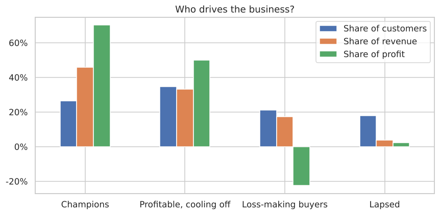
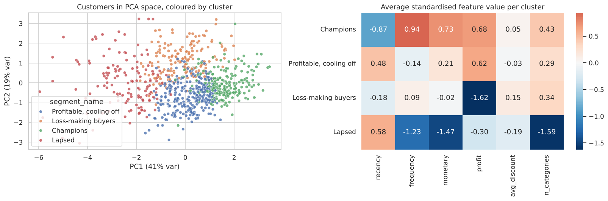

# Customer Segmentation with RFM and K-Means

Grouping a retailer's customers by how they actually buy, then turning each group into a concrete marketing action. Adding **profit** to classic RFM turned up a segment of customers who look valuable but lose the company money.



## The data

Four years (2009-2012) of orders from a Canadian office-supplies superstore: 8,399 order lines, 5,496 orders, 795 customers. Included in `data/`.

## What I did

1. **Built customer-level features:** Recency, Frequency and Monetary value (RFM), plus total profit, average discount and number of product categories bought.
2. **Rule-based RFM scoring** (quintile scores mapped to named segments) as a simple, explainable baseline.
3. **K-Means clustering** on log-transformed, standardised features. I chose k using the elbow method, silhouette and Davies-Bouldin scores, plus whether the groups were useful for marketing.
4. **Profiled each cluster**, named it, and measured its share of revenue and profit.
5. **Investigated** why one segment loses money.



## The segments

| Segment | Customers | Median last order | Median orders | Median spend | Revenue share | Profit share |
|---|---|---|---|---|---|---|
| **Champions** | 211 (27%) | 60 days | 10 | $27,762 | 46% | **70%** |
| **Profitable, cooling off** | 275 (35%) | 248 days | 6 | $16,011 | 33% | 50% |
| **Loss-making buyers** | 167 (21%) | 127 days | 6 | $12,532 | 17% | **-22%** |
| **Lapsed** | 142 (18%) | 307 days | 3 | $2,905 | 4% | 2% |

Profit shares add to more than 100% because the loss-making segment's share is negative.

**Key findings**
- A quarter of customers bring in **70% of profit**.
- **Loss-making buyers** spend real money but lose the company **$341k** in total. Rule-based RFM spreads them across all of its segments, including "Champions". They only show up as a group once profit is part of the clustering.
- The cause isn't discounts (the same ~5% for every segment). These customers buy more **furniture** and pricier, **more expensive-to-ship** items, and 63% of their order lines lose money.

## Recommended actions

| Segment | Action |
|---|---|
| Champions | Protect them: account management, early access, volume pricing |
| Profitable, cooling off | **Biggest opportunity:** win-back campaign before they lapse |
| Loss-making buyers | Fix shipping charges and minimum order values on bulky orders before marketing to them |
| Lapsed | Low-cost automated re-engagement only |

## A note on the method

Silhouette scores are modest (about 0.2 at k = 4, 0.3 at k = 2). Customer behaviour is a continuum, not separate blobs. k = 2 scored best but only split big customers from small ones. I picked k = 4 because it's the smallest number that separates the groups marketing would treat differently.

## Run it

```bash
pip install -r requirements.txt
jupyter notebook customer_segmentation.ipynb
```

Per-customer segment labels are saved in `results/customer_segments.csv`.
